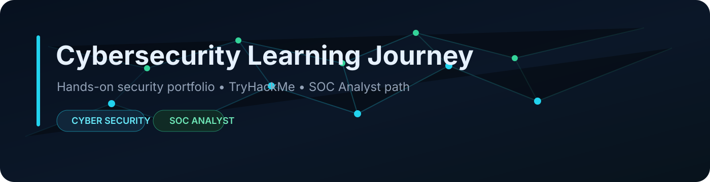

<p align="center">
  
</p>

<p align="center">
  
  
  
</p>

<p align="center">
  <a href="README.md">🇬🇧 English</a> · <strong>🇮🇹 Italiano</strong>
</p>

# Cybersecurity Learning Journey

Portfolio pratico di cybersecurity basato su **TryHackMe**, lab selezionati e competenze orientate a un ruolo entry-level come **SOC Analyst**.

> [!NOTE]
> Questa repository è organizzata in **percorsi di apprendimento separati**, non come un unico corso continuo. Solo gli esercizi con reale valore da portfolio diventano lab completi.

## 🧭 Percorsi di apprendimento

### 01 — Cyber Security 101
**Stato:** ✅ Completato

L'intero percorso Cyber Security 101 è completato e ha coperto sistemi, networking, crittografia, exploitation, web security, tooling offensivo, sicurezza difensiva, soluzioni di sicurezza, strumenti di analisi e concetti OWASP.

🎓 **Certificate of Completion:** [TryHackMe — Cyber Security 101](https://tryhackme.com/certificate/THM-MFXAZOLNRP)  
**Completato:** 29 ottobre 2026 · **Durata:** 45 h 23 min

I tre portfolio lab selezionati sono completati: il percorso è quindi chiuso come base tecnica documentata per **SOC Level 1**.

➡️ **[Apri Cyber Security 101](01-cyber-security-101/README_IT.md)**

### 02 — SOC Level 1
**Stato:** ⏭️ Prossimo percorso

Specializzazione orientata al SOC: monitoraggio, log, SIEM, triage degli alert, analisi network/endpoint, phishing, investigation, escalation e reporting.

➡️ **[Apri SOC Level 1](02-soc-level-1/README_IT.md)**

## 🧪 Portfolio Labs

### 01 · Basic Network Traffic Analysis
✅ **Completato**

Analisi di pacchetti e protocolli con **Wireshark** e **tcpdump**, includendo ICMP, DNS, HTTP/HTTPS, TCP handshake, indirizzamento, routing e neighbour discovery.

➡️ **[Apri Lab 01](01-cyber-security-101/01-networking/basic-network-traffic-analysis/README_IT.md)**

### 02 · Cryptography and Password Security
✅ **Completato**

Attività pratiche con **SHA-256**, **Hashcat**, hash con salt, **AES**, **RSA** e firme digitali.

➡️ **[Apri Lab 02](01-cyber-security-101/02-cryptography/cryptography-and-password-security/README_IT.md)**

### 03 · Web Application Security Assessment
✅ **Completato**

Assessment completo e autorizzato che unisce **Burp Suite**, fondamenti web, tooling offensivo (**Gobuster**, **SQLMap**, **Hydra**), test manuali di SQL injection e classificazione del rischio con **OWASP Top 10 (2025)**.

➡️ **[Apri Lab 03](01-cyber-security-101/04-web-security/web-application-security-assessment/README_IT.md)**

> [!IMPORTANT]
> Cyber Security 101 e i tre portfolio lab selezionati sono completati. La prossima fase del portfolio sarà dedicata alle **investigation di SOC Level 1**, con focus su triage, analisi delle evidenze, correlazione e reporting.

## 🧰 Toolset

**Systems**  
`Linux` · `Windows` · `Active Directory` · `PowerShell`

**Network & Traffic**  
`Nmap` · `Wireshark` · `tcpdump`

**Offensive Security**  
`Burp Suite` · `Metasploit` · `Gobuster` · `Hydra` · `SQLMap`

**Cryptography & Password Security**  
`OpenSSL` · `Hashcat` · `John the Ripper`

**Defensive Analysis**  
`SIEM concepts` · `IDS/IPS` · `CyberChef` · `CAPA` · `REMnux` · `FlareVM`

## 🛣️ Direzione

```text
01 — Cyber Security 101 ✅
        ↓
Lab 01 ✅ · Lab 02 ✅ · Lab 03 ✅
        ↓
02 — SOC Level 1
        ↓
Selected SOC Investigation Labs
        ↓
SOC Analyst / Incident Response
```

Le attività più dettagliate di system administration sono mantenute nella repository separata **[IT Systems Administration Labs](https://github.com/roccomazzei/it-systems-administration-labs)** per evitare duplicazioni.
