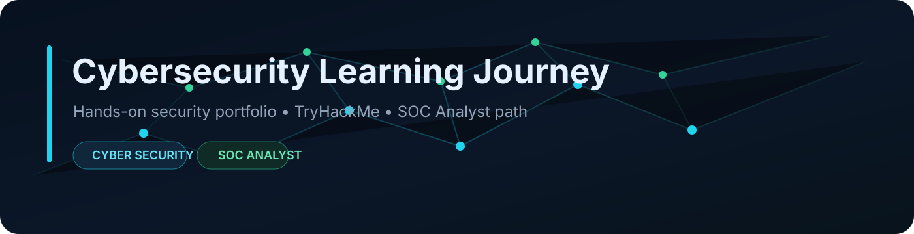

<p align="center">
  
</p>

<p align="center">
  
  
  
</p>

<p align="center">
  <a href="README.md">🇬🇧 English</a> · <strong>🇮🇹 Italiano</strong>
</p>

# Cybersecurity Learning Journey

Portfolio pratico di cybersecurity basato su **TryHackMe**, lab selezionati e competenze orientate a un ruolo entry-level come **SOC Analyst**.

> [!NOTE]
> Questa repository è organizzata in **percorsi di apprendimento separati**, non come un unico corso continuo. Solo gli esercizi con reale valore da portfolio diventano lab completi.

## 🧭 Percorsi di apprendimento

### 01 — Cyber Security 101
**Stato:** ✅ Completato

L'intero percorso Cyber Security 101 è completato e ha coperto sistemi, networking, crittografia, exploitation, web security, tooling offensivo, sicurezza difensiva, soluzioni di sicurezza, strumenti di analisi e concetti OWASP.

Il lavoro rimanente per questo modulo riguarda esclusivamente il **consolidamento del portfolio tramite lab pratici selezionati**.

➡️ **[Apri Cyber Security 101](01-cyber-security-101/README_IT.md)**

### 02 — SOC Level 1
**Stato:** ⏭️ Prossimo percorso

Specializzazione orientata al SOC: monitoraggio, log, SIEM, triage degli alert, analisi network/endpoint, phishing, investigation, escalation e reporting.

➡️ **[Apri SOC Level 1](02-soc-level-1/README_IT.md)**

## 🧪 Portfolio Labs

### 01 · Basic Network Traffic Analysis
✅ **Completato**

Analisi di pacchetti e protocolli con **Wireshark** e **tcpdump**, includendo ICMP, DNS, HTTP/HTTPS, TCP handshake, indirizzamento, routing e neighbour discovery.

➡️ **[Apri Lab 01](01-cyber-security-101/01-networking/basic-network-traffic-analysis/README_IT.md)**

### 02 · Cryptography and Password Security
✅ **Completato**

Attività pratiche con **SHA-256**, **Hashcat**, hash con salt, **AES**, **RSA** e firme digitali.

➡️ **[Apri Lab 02](01-cyber-security-101/02-cryptography/cryptography-and-password-security/README_IT.md)**

### 03 · Web Application Security Assessment
🟡 **Prossimo traguardo pratico**

Assessment completo e autorizzato che unirà **Burp Suite**, fondamenti web, tooling offensivo, test SQL injection e concetti **OWASP**.

> [!IMPORTANT]
> Cyber Security 101 è già completato. Il focus attuale è trasformare le conoscenze acquisite in lab solidi e leggibili da un recruiter prima di passare a **SOC Level 1**.

## 🧰 Toolset

**Systems**  
`Linux` · `Windows` · `Active Directory` · `PowerShell`

**Network & Traffic**  
`Nmap` · `Wireshark` · `tcpdump`

**Offensive Security**  
`Burp Suite` · `Metasploit` · `Gobuster` · `Hydra` · `SQLMap`

**Cryptography & Password Security**  
`OpenSSL` · `Hashcat` · `John the Ripper`

**Defensive Analysis**  
`SIEM concepts` · `IDS/IPS` · `CyberChef` · `CAPA` · `REMnux` · `FlareVM`

## 🛣️ Direzione

```text
01 — Cyber Security 101 ✅
        ↓
Completamento Portfolio Labs
        ↓
Lab 03 — Web Application Security Assessment
        ↓
02 — SOC Level 1
        ↓
Selected SOC Investigation Labs
        ↓
SOC Analyst / Incident Response
```

Le attività più dettagliate di system administration sono mantenute nella repository separata **IT Systems Administration Labs** per evitare duplicazioni.
